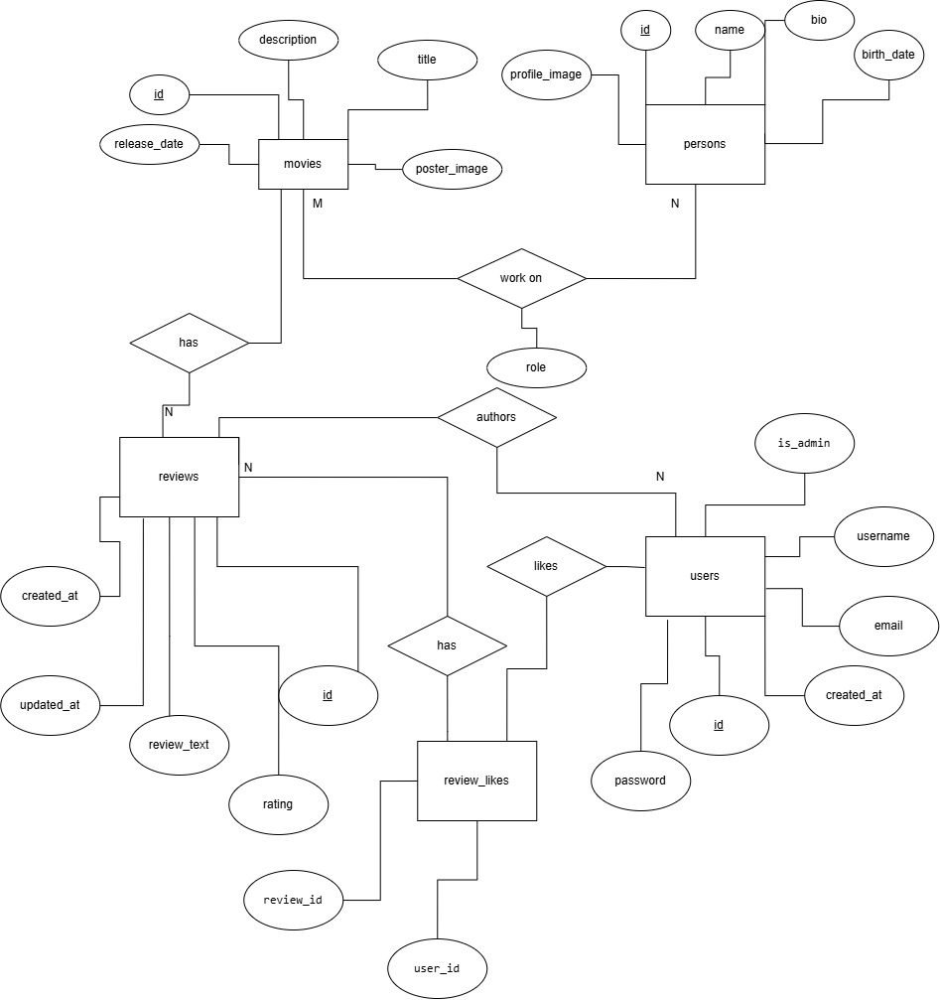

# เว็บแอปพลิเคชันรีวิวภาพยนตร์ (Movie Reviews)

โปรเจกต์สำหรับฝึกพัฒนาเว็บด้วย Go และ MySQL แสดงผลผ่านหน้า HTML สำหรับดูรายการภาพยนตร์ เพิ่มภาพยนตร์ และอ่านรีวิว ปัจจุบันยังอยู่ระหว่างพัฒนา โดยเส้นทางสมัครสมาชิก เข้าสู่ระบบ และส่งรีวิวยังตอบกลับเป็นข้อความตัวอย่าง

## สารบัญ

- [ฟีเจอร์และสถานะปัจจุบัน](#features)
- [เทคโนโลยีที่ใช้](#tech-stack)
- [โครงสร้างโปรเจกต์](#project-structure)
- [วิธีติดตั้งและเริ่มใช้งาน](#getting-started)
- [เส้นทาง HTTP](#http-routes)
- [โมเดลฐานข้อมูล](#database-models)
- [แผนภาพฐานข้อมูล](#database-diagrams)
- [ข้อจำกัดปัจจุบัน](#known-limitations)

<a id="features"></a>

## ฟีเจอร์และสถานะปัจจุบัน

- แสดงภาพยนตร์ที่เพิ่มล่าสุด 10 เรื่อง เรียงตาม ID จากมากไปน้อย
- แสดงรายละเอียดภาพยนตร์พร้อมรีวิว โดยแบ่งรีวิวหน้าละ 10 รายการ
- เรียงรีวิวจากใหม่ไปเก่าเป็นค่าเริ่มต้น หรือเรียงตามจำนวนไลก์ด้วย `?sort=popular`
- เพิ่มภาพยนตร์ผ่านฟอร์ม HTML พร้อมตรวจสอบชื่อเรื่องและวันที่เข้าฉาย
- แสดงข้อความแจ้งผลหลังเพิ่มภาพยนตร์สำเร็จ โดยเก็บข้อความชั่วคราวไว้ในเซสชัน
- แคชเทมเพลต HTML ตอนเริ่มโปรแกรม และให้บริการไฟล์ CSS, JavaScript และรูปภาพ
- ให้บริการผ่าน HTTPS พร้อมบันทึกคำขอ จัดการ panic ตั้งค่า HTTP headers ด้านความปลอดภัย และกำหนดเวลารอของเซิร์ฟเวอร์
- เก็บเซสชันใน MySQL กำหนดอายุ 12 ชั่วโมง และตั้งค่าคุกกี้เป็น `Secure`

หน้าแรกมีโค้ดที่สั่งให้เกิด panic และ middleware จะจัดการโดยตอบกลับ HTTP 500 จึงควรเริ่มใช้งานที่ `/movies/` แทน `/`

<a id="tech-stack"></a>

## เทคโนโลยีที่ใช้

| ส่วนประกอบ | เทคโนโลยี |
|------------|-----------|
| ภาษา | Go โดย `go.mod` ระบุ `go 1.27.1` |
| เว็บเซิร์ฟเวอร์และการกำหนดเส้นทาง | ไลบรารีมาตรฐาน `net/http` |
| ฐานข้อมูล | MySQL ผ่าน `database/sql` และ `github.com/go-sql-driver/mysql` |
| เทมเพลต | ไลบรารีมาตรฐาน `html/template` |
| การบันทึก log | ไลบรารีมาตรฐาน `log/slog` |
| การเรียงลำดับ middleware | `github.com/justinas/alice` |
| เซสชัน | `github.com/alexedwards/scs/v2` ร่วมกับ `scs/mysqlstore` |
| การแปลงข้อมูลจากฟอร์ม | `github.com/go-playground/form/v4` |
| ส่วนติดต่อผู้ใช้ | HTML, CSS และ JavaScript |

เวอร์ชันของแพ็กเกจที่ใช้ระบุไว้ใน [go.mod](./go.mod) และ [go.sum](./go.sum)

<a id="project-structure"></a>

## โครงสร้างโปรเจกต์

```text
movie-reviews/
|-- cmd/web/
|   |-- main.go              # ตั้งค่าโปรแกรม ฐานข้อมูล เซสชัน และเซิร์ฟเวอร์ HTTPS
|   |-- routes.go            # กำหนดเส้นทางและลำดับ middleware
|   |-- handler.go           # จัดการหน้าเว็บ ฟอร์ม และเส้นทางที่ยังเป็นตัวอย่าง
|   |-- middleware.go        # ตั้งค่า headers บันทึกคำขอ และจัดการ panic
|   |-- helpers.go           # แสดงผล จัดการข้อผิดพลาด แปลงฟอร์ม และเตรียมข้อมูลร่วม
|   `-- templates.go         # แคชเทมเพลต ฟังก์ชัน และชนิดข้อมูลสำหรับหน้าเว็บ
|-- internal/
|   |-- models/
|   |   |-- movies.go        # อ่านและเพิ่มข้อมูลภาพยนตร์
|   |   |-- review.go        # อ่าน เพิ่ม แก้ไข และลบรีวิว
|   |   |-- persons.go       # อ่านและเพิ่มข้อมูลบุคคล
|   |   |-- movie_person.go  # นักแสดง ผลงาน และความสัมพันธ์กับภาพยนตร์
|   |   `-- errors.go        # ข้อผิดพลาด ErrNoRecord
|   `-- validator/
|       `-- validator.go     # ฟังก์ชันตรวจสอบข้อมูลฟอร์ม
|-- ui/
|   |-- html/
|   |   |-- base.tmpl
|   |   |-- partials/nav.tmpl
|   |   `-- pages/           # หน้า movies, detail, add; ไฟล์ home และ review ยังว่าง
|   `-- static/              # CSS, JavaScript และรูปภาพ
|-- docs/                    # แผนภาพฐานข้อมูล
|-- tls/                     # cert.pem และ key.pem ในเครื่อง ไม่ติดตามด้วย Git
|-- go.mod
`-- go.sum
```

<a id="getting-started"></a>

## วิธีติดตั้งและเริ่มใช้งาน

### 1. เตรียมเครื่องมือและดาวน์โหลดโปรเจกต์

- Go เวอร์ชันที่รองรับข้อกำหนด `go 1.27.1` ใน `go.mod` 
- เซิร์ฟเวอร์ MySQL ที่กำลังทำงาน และบัญชีที่มีสิทธิ์สร้างฐานข้อมูลสำหรับพัฒนา
- ใบรับรอง TLS และ private key สำหรับใช้งานในเครื่อง ตามขั้นตอนด้านล่าง

```sh
git clone https://github.com/Zetshin/movie-reviews.git
cd movie-reviews
go mod download
```

รันคำสั่งของแอปพลิเคชันจากโฟลเดอร์หลักของโปรเจกต์ เพราะโปรแกรมโหลดเทมเพลต ไฟล์ static และไฟล์ TLS โดยอ้างอิงพาธจากโฟลเดอร์ที่รัน

### 2. สร้างฐานข้อมูลสำหรับพัฒนา

โปรเจกต์ยังไม่มีไฟล์ migration หรือสคริปต์เพิ่มข้อมูลเริ่มต้น SQL ด้านล่างเป็นตัวอย่างโครงสร้างสำหรับ **ฐานข้อมูลใหม่เพื่อใช้พัฒนา** โดยอ้างอิงคำสั่ง SQL ในโค้ดปัจจุบัน รวมตาราง `review_likes` ที่คำสั่งอ่านรีวิวต้องใช้ JOIN แม้ยังไม่มีรีวิว และตาราง `sessions` สำหรับจัดเก็บเซสชัน

รัน SQL นี้ผ่านโปรแกรมจัดการ MySQL:

```sql
CREATE DATABASE movies CHARACTER SET utf8mb4 COLLATE utf8mb4_unicode_ci;
USE movies;

CREATE TABLE movies (
    id           INT AUTO_INCREMENT PRIMARY KEY,
    title        VARCHAR(255) NOT NULL,
    description  TEXT NOT NULL,
    release_date DATE NOT NULL,
    poster_image TEXT NOT NULL,
    review_count INT NOT NULL DEFAULT 0,
    avg_rating   DECIMAL(3,2) NOT NULL DEFAULT 0.00
);

CREATE TABLE persons (
    id            INT AUTO_INCREMENT PRIMARY KEY,
    name          VARCHAR(255) NOT NULL,
    bio           TEXT NOT NULL,
    birth_date    DATE NOT NULL,
    profile_image TEXT NOT NULL
);

CREATE TABLE movie_person (
    movie_id  INT NOT NULL,
    person_id INT NOT NULL,
    role      VARCHAR(100) NOT NULL,
    PRIMARY KEY (movie_id, person_id),
    FOREIGN KEY (movie_id) REFERENCES movies(id),
    FOREIGN KEY (person_id) REFERENCES persons(id)
);

CREATE TABLE users (
    id         INT AUTO_INCREMENT PRIMARY KEY,
    username   VARCHAR(255) NOT NULL,
    email      VARCHAR(255) NOT NULL,
    password   VARCHAR(255) NOT NULL,
    created_at DATETIME NOT NULL DEFAULT CURRENT_TIMESTAMP
);

CREATE TABLE reviews (
    id          INT AUTO_INCREMENT PRIMARY KEY,
    movie_id    INT NOT NULL,
    user_id     INT NOT NULL,
    rating      INT NOT NULL,
    review_text TEXT NOT NULL,
    created_at  DATETIME NOT NULL DEFAULT CURRENT_TIMESTAMP,
    updated_at  DATETIME NOT NULL DEFAULT CURRENT_TIMESTAMP ON UPDATE CURRENT_TIMESTAMP,
    FOREIGN KEY (movie_id) REFERENCES movies(id),
    FOREIGN KEY (user_id) REFERENCES users(id)
);

CREATE TABLE review_likes (
    review_id INT NOT NULL,
    user_id   INT NOT NULL,
    PRIMARY KEY (review_id, user_id),
    FOREIGN KEY (review_id) REFERENCES reviews(id),
    FOREIGN KEY (user_id) REFERENCES users(id)
);

CREATE TABLE sessions (
    token  CHAR(43) COLLATE utf8mb4_bin PRIMARY KEY,
    data   BLOB NOT NULL,
    expiry TIMESTAMP(6) NOT NULL,
    INDEX sessions_expiry_idx (expiry)
);
```

ตาราง `users` เป็นตัวอย่างสำหรับรองรับความสัมพันธ์กับรีวิว ปัจจุบันยังไม่มีโมเดลผู้ใช้หรือระบบยืนยันตัวตนที่ใช้งานได้ หน้าเว็บแสดงคะแนนเต็ม 5 แต่โมเดลรีวิวยังไม่ตรวจสอบช่วงคะแนน ส่วน `PersonModel.Get` ใช้ชื่อคอลัมน์ไม่ตรงกับรูปแบบ snake_case ในตัวอย่างข้างต้น ดูรายละเอียดใน [ข้อจำกัดปัจจุบัน](#known-limitations)

สร้างบัญชีฐานข้อมูลสำหรับแอปพลิเคชัน โดยเปลี่ยนรหัสผ่านตัวอย่างก่อนใช้งาน:

```sql
CREATE USER 'movie_app'@'localhost' IDENTIFIED BY 'change-this-password';
GRANT SELECT, INSERT, UPDATE, DELETE ON movies.* TO 'movie_app'@'localhost';
```

คอลัมน์ที่โมเดลอ่านควรมีค่าที่ไม่ใช่ `NULL` เพราะโค้ดอ่านลงตัวแปรชนิดสตริง จำนวนเต็ม และ `time.Time` โดยตรง และต้องมี `parseTime=true` ในสตริงเชื่อมต่อเพื่ออ่านคอลัมน์วันที่และเวลา

### 3. ตั้งค่า HTTPS ในเครื่อง

เซิร์ฟเวอร์ต้องใช้ `tls/cert.pem` และ `tls/key.pem` ซึ่ง Git ไม่ติดตาม จึงต้องเตรียมไฟล์เหล่านี้ในเครื่อง หากยังไม่มี สามารถสร้างใบรับรองแบบลงนามด้วยตนเองสำหรับพัฒนาด้วยเครื่องมือที่มาพร้อม Go

สำหรับ PowerShell ให้เริ่มจากโฟลเดอร์หลักของโปรเจกต์:

```powershell
New-Item -ItemType Directory -Force tls | Out-Null
Push-Location tls
go run "$(go env GOROOT)/src/crypto/tls/generate_cert.go" -host "localhost,127.0.0.1,::1"
Pop-Location
```

สำหรับ Bash ให้เริ่มจากโฟลเดอร์หลักของโปรเจกต์:

```sh
mkdir -p tls
cd tls
go run "$(go env GOROOT)/src/crypto/tls/generate_cert.go" -host "localhost,127.0.0.1,::1"
cd ..
```

เครื่องมือนี้จะเขียนทับ `cert.pem` และ `key.pem` หากมีอยู่แล้วในโฟลเดอร์ที่รัน เบราว์เซอร์จะแสดงคำเตือนเกี่ยวกับใบรับรอง เนื่องจากเป็นใบรับรองที่ลงนามด้วยตนเอง

### 4. รันแอปพลิเคชัน

```sh
go run ./cmd/web -dsn "movie_app:change-this-password@tcp(localhost:3306)/movies?parseTime=true"
```

เปิด [https://localhost:4000/movies/](https://localhost:4000/movies/) ฐานข้อมูลใหม่จะยังไม่มีภาพยนตร์ สามารถเพิ่มได้ที่ [หน้าเพิ่มภาพยนตร์](https://localhost:4000/movies/add)

| ตัวเลือก | ค่าเริ่มต้น | คำอธิบาย |
|----------|-------------|----------|
| `-addr` | `:4000` | ที่อยู่และพอร์ตที่เซิร์ฟเวอร์ HTTPS รับการเชื่อมต่อ |
| `-dsn` | `user:pass@/movies?parseTime=true` | สตริงเชื่อมต่อ MySQL ต้องเปลี่ยนชื่อผู้ใช้และรหัสผ่านให้ตรงกับฐานข้อมูล |

หากต้องการเปลี่ยนพอร์ต:

```sh
go run ./cmd/web -addr ":8080" -dsn "movie_app:change-this-password@tcp(localhost:3306)/movies?parseTime=true"
```

จากนั้นเปิด [https://localhost:8080/movies/](https://localhost:8080/movies/) เซิร์ฟเวอร์ให้บริการผ่าน HTTPS เท่านั้น ยังไม่มีตัวรับการเชื่อมต่อ HTTP เพื่อเปลี่ยนเส้นทางไป HTTPS

<a id="http-routes"></a>

## เส้นทาง HTTP

เส้นทางเหล่านี้ตอบกลับเป็น HTML หรือข้อความธรรมดา ไม่ใช่ JSON API โดยกำหนดไว้ใน [cmd/web/routes.go](./cmd/web/routes.go)

| เมธอด | เส้นทาง | พฤติกรรมปัจจุบัน |
|-------|---------|-----------------|
| GET | `/` | สั่งให้เกิด panic และ middleware ตอบกลับ 500 |
| GET | `/profile` | แสดงข้อความตัวอย่าง |
| GET | `/movies/` | แสดงภาพยนตร์ที่เพิ่มล่าสุด 10 เรื่อง |
| GET | `/movies/{movieID}` | แสดงรายละเอียดภาพยนตร์และรีวิวแบบแบ่งหน้า |
| GET | `/movies/add` | แสดงฟอร์มเพิ่มภาพยนตร์ |
| POST | `/movies/add` | ตรวจสอบและบันทึกภาพยนตร์ ตั้งข้อความแจ้งผล และเปลี่ยนเส้นทางด้วยสถานะ 303 |
| GET | `/movies/{movieID}/review` | แสดงข้อความตัวอย่าง ตรวจสอบเพียงว่า ID เป็นจำนวนเต็มบวก |
| POST | `/movies/{movieID}/review` | แสดงข้อความตัวอย่าง ยังไม่บันทึกรีวิว |
| GET | `/persons/` | ตอบกลับ 404 เพราะเส้นทางไม่มีพารามิเตอร์ ID ให้ handler อ่าน |
| GET | `/user/signup` | แสดงข้อความตัวอย่างสำหรับหน้าสมัครสมาชิก |
| POST | `/user/signup` | แสดงข้อความตัวอย่าง ยังไม่สร้างบัญชี |
| GET | `/user/login` | แสดงข้อความตัวอย่างสำหรับหน้าเข้าสู่ระบบ |
| POST | `/user/login` | แสดงข้อความตัวอย่าง ยังไม่ยืนยันตัวตน |
| POST | `/user/logout` | แสดงข้อความตัวอย่าง ยังไม่ดำเนินการออกจากระบบ |
| GET | `/static/` | ให้บริการไฟล์ภายใน `ui/static/` |

เส้นทางเดิม `POST /movies/create` ไม่มีการลงทะเบียนแล้ว ส่วน `/movies/` ลงทะเบียนเป็นรูปแบบที่ครอบคลุมเส้นทางย่อย ดังนั้นคำขอ GET ภายใต้เส้นทางนี้ที่ไม่ตรงกับเส้นทางอื่นอาจถูกส่งไปยัง handler แสดงรายการภาพยนตร์ได้

พารามิเตอร์ใน URL ของหน้ารายละเอียดภาพยนตร์:

- `page`: เลขหน้าที่เป็นจำนวนเต็มบวก ค่าเริ่มต้นคือ `1` แสดงรีวิวหน้าละ 10 รายการ หากรูปแบบไม่ถูกต้องหรือเกินจำนวนหน้าจะตอบกลับ 404 แต่อนุญาตให้เปิดหน้า 1 ได้เมื่อยังไม่มีรีวิว
- `sort=popular`: เรียงตามจำนวนไลก์จากมากไปน้อย แล้วเรียงตามเวลาสร้างและ ID จากมากไปน้อยตามลำดับ ค่าอื่นจะเรียงตามเวลาสร้างและ ID จากมากไปน้อย

ตัวอย่าง `/movies/1?page=2&sort=popular` จะแสดงรีวิวหน้าที่ 2 ของภาพยนตร์ ID 1 โดยเรียงตามความนิยม หากมีรีวิวมากพอสำหรับหน้านั้น

ฟอร์มเพิ่มภาพยนตร์รับค่า `title`, `description`, `release_date` และ `poster_image` โดยต้องระบุชื่อเรื่องไม่เกิน 100 ตัวอักษร และวันที่เข้าฉายในรูปแบบ `YYYY-MM-DD` หากไม่ผ่านการตรวจสอบช่องข้อมูลจะตอบกลับ 422 ส่วนข้อผิดพลาดในการแปลงข้อมูลฟอร์มหรือวันที่จะตอบกลับ 400 คำอธิบายและรูปโปสเตอร์สามารถเว้นว่างได้

<a id="database-models"></a>

## โมเดลฐานข้อมูล

| โมเดล | เมธอด | การเชื่อมต่อกับหน้าเว็บ |
|-------|-------|-----------------------|
| `MovieModel` | `Insert`, `Get`, `Latest`, `TopPicks` | ใช้ในหน้ารายการ รายละเอียด และการเพิ่มภาพยนตร์ ส่วน `TopPicks` ยังไม่ได้ใช้งาน |
| `ReviewModel` | `ListByMovieID`, `CountByMovieID`, `GetRandom`, `Insert`, `Delete`, `Update` | หน้ารายละเอียดภาพยนตร์ใช้เมธอดอ่านรายการและนับรีวิว เมธอดอื่นยังไม่เชื่อมต่อกับเส้นทาง |
| `PersonModel` | `Insert`, `Get` | ยังไม่ได้สร้างอินสแตนซ์ในแอปพลิเคชันหรือเชื่อมต่อกับหน้าที่ใช้งานได้ |
| `MoviePersonModel` | `Insert`, `GetCastMembers`, `GetFilmography` | ยังไม่ได้สร้างอินสแตนซ์ในแอปพลิเคชันหรือเชื่อมต่อกับหน้าเว็บ |

`TopPicks` เลือกภาพยนตร์ที่มี `avg_rating > 4.00` สูงสุด 5 เรื่อง เรียงตามคะแนนจากมากไปน้อย ส่วน `GetRandom` สุ่มรีวิว 1 รายการที่มี `rating > 3` จำนวนไลก์ของรีวิวคำนวณด้วย SQL JOIN แต่ยังไม่มีเส้นทางสำหรับกดหรือยกเลิกไลก์

<a id="database-diagrams"></a>

## แผนภาพฐานข้อมูล

ไฟล์อ้างอิงการออกแบบอยู่ใน `docs/` เมื่อตั้งค่าฐานข้อมูลควรตรวจสอบคำสั่ง SQL ในโมเดลปัจจุบันและข้อกำหนดของระบบเซสชันร่วมด้วย แผนภาพเหล่านี้ไม่ได้ใช้สร้างหรือปรับโครงสร้างฐานข้อมูลโดยอัตโนมัติ

### โครงสร้างฐานข้อมูลระดับกายภาพ


### โครงสร้างฐานข้อมูลระดับแนวคิด



ไฟล์ต้นฉบับที่แก้ไขได้: [conceptual-ER .drawio](./docs/conceptual-ER%20.drawio)

<a id="known-limitations"></a>

## ข้อจำกัดปัจจุบัน

- Handler ของหน้าแรกมีคำสั่งให้เกิด panic ไฟล์ `home.tmpl` และ `review.tmpl` ยังว่าง และเทมเพลตหลักยังแสดงชื่อ "Snippetbox" จากบทเรียน
- หน้าสมัครสมาชิก เข้าสู่ระบบ ออกจากระบบ โปรไฟล์ และเส้นทาง GET/POST ของรีวิวยังเป็นข้อความตัวอย่าง แม้มีระบบจัดเก็บเซสชันแล้ว แต่ยังไม่มีการยืนยันตัวตนหรือตรวจสอบสิทธิ์
- การเพิ่มภาพยนตร์ยังไม่บังคับให้เข้าสู่ระบบ และยังไม่มีการป้องกัน CSRF
- Handler `movieReviews` ยังไม่ได้ลงทะเบียนเส้นทาง ปัจจุบันใช้ `movieDetail` แสดงรีวิว
- ลิงก์เปลี่ยนหน้าไม่ได้ส่งพารามิเตอร์ `sort` ต่อไปด้วย เมื่อกดเปลี่ยนหน้าจึงกลับไปใช้การเรียงลำดับเริ่มต้น และเมื่อไม่มีรีวิวจะแสดง "Page 1 of 0"
- ค่าโปสเตอร์แสดงเป็นข้อความ ยังไม่ได้แสดงเป็นรูปภาพ
- `/persons/` ไม่ได้รับค่า `id` ที่ `personDetail` ต้องใช้ และ `PersonModel.Get` อ่านคอลัมน์ `birthDate` กับ `profileImage` ขณะที่ `Insert` ใช้ `birth_date` กับ `profile_image`
- เมธอดเพิ่ม แก้ไข และลบรีวิวยังไม่ปรับค่า `movies.review_count` หรือ `movies.avg_rating` แอปพลิเคชันจึงยังไม่คำนวณค่าสรุปเหล่านี้ใหม่โดยอัตโนมัติ
- ข้อผิดพลาดตอบกลับเป็นข้อความ HTTP มาตรฐาน ยังไม่มีหน้าแสดงข้อผิดพลาดที่ออกแบบไว้เฉพาะ
- ยังไม่มีไฟล์ทดสอบอัตโนมัติ ไฟล์ migration หรือสคริปต์เพิ่มข้อมูลเริ่มต้น

## ผู้พัฒนา

[Zetshin](https://github.com/Zetshin)

โปรเจกต์ส่วนตัวสำหรับฝึกพัฒนาเว็บด้วย Go และออกแบบฐานข้อมูลเชิงสัมพันธ์
